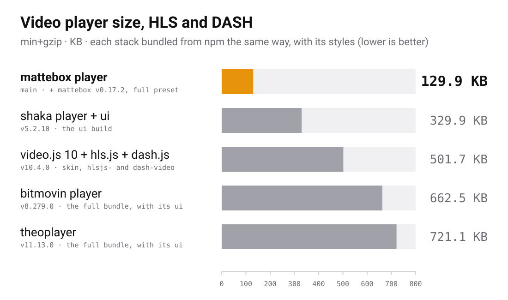
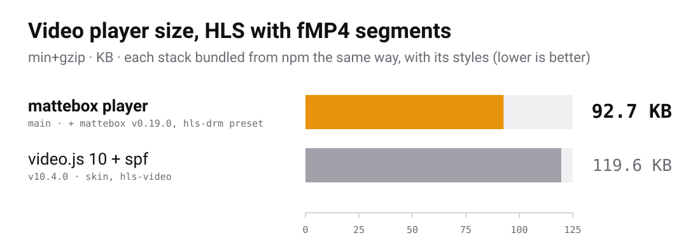
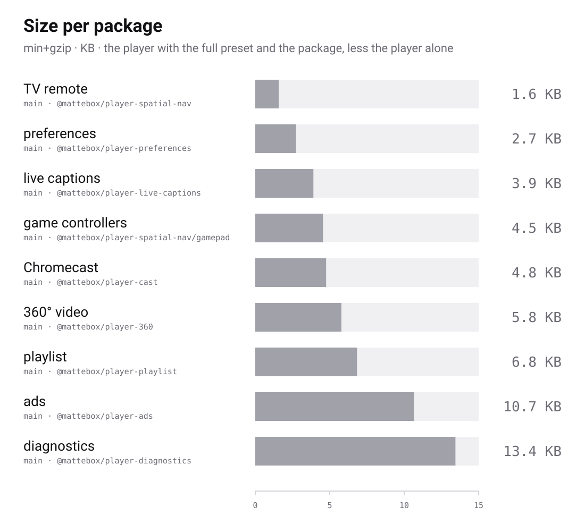

<h1>
  
  Mattebox player
</h1>

[](https://github.com/jboix/mattebox-player/actions/workflows/quality.yml)
[](./LICENSE)

The Mattebox player is eleven packages over the
[mattebox](https://github.com/jboix/mattebox) engine. The engine feeds a
MediaSource and never sets the `src` of the video. The player decides which
handler to use, and adds a custom UI on top of it.

| Package                          | Version                                                                                                                             | What it is                                                                                                                                                                          | Side effects                     |
| -------------------------------- | ----------------------------------------------------------------------------------------------------------------------------------- | ----------------------------------------------------------------------------------------------------------------------------------------------------------------------------------- | -------------------------------- |
| `@mattebox/player-core`          | [](https://www.npmjs.com/package/@mattebox/player-core)                   | The layer without a UI. It resolves a source through your connectors and runs the handler chain. About three kilobytes                                                              | None                             |
| `@mattebox/player`               | [](https://www.npmjs.com/package/@mattebox/player)                             | The `<mattebox-player>` custom element over the core. No framework                                                                                                                  | Registers the element on import  |
| `@mattebox/player-diagnostics`   | [](https://www.npmjs.com/package/@mattebox/player-diagnostics)     | `<mbx-diagnostics>`. The stats, the charts and the browser's support inside the player, and a report to send                                                                        | Registers the element on import  |
| `@mattebox/player-cast`          | [](https://www.npmjs.com/package/@mattebox/player-cast)                   | `<mbx-cast-button>`. Chromecast from the player, over Google's sender SDK                                                                                                           | Registers the element on import  |
| `@mattebox/player-spatial-nav`   | [](https://www.npmjs.com/package/@mattebox/player-spatial-nav)     | `<mbx-spatial-nav>`. The remote control on a TV: focus moves with the arrows, and the remote's keys reach the player                                                                | Registers the element on import  |
| `@mattebox/player-playlist`      | [](https://www.npmjs.com/package/@mattebox/player-playlist)           | The playlist from markup or a script, its controls, and the up next card                                                                                                            | Registers the element on import  |
| `@mattebox/player-preferences`   | [](https://www.npmjs.com/package/@mattebox/player-preferences)     | `<mbx-preferences>` and a store. The viewer's tracks, volume, rate, quality and subtitle look, kept across programmes and visits                                                    | Registers the element on import  |
| `@mattebox/player-ads`           | [](https://www.npmjs.com/package/@mattebox/player-ads)                     | Ads: HLS interstitials, DASH alternative MPD, SCTE-35 cue-outs, VAST and VMAP, the ad controls and the beacons                                                                      | Registers the element on import  |
| `@mattebox/player-live-captions` | [](https://www.npmjs.com/package/@mattebox/player-live-captions) | `<mbx-live-captions>`. What is said, written over the video by the browser's speech recognition, on the device                                                                      | Registers the element on import  |
| `@mattebox/player-360`           | [](https://www.npmjs.com/package/@mattebox/player-360)                     | `<mbx-360>`, `<mbx-motion-button>` and `<mbx-vr-button>`. A 360° video seen from inside, turned by a drag, the wheel, a game controller or the device, and shown in a WebXR headset | Registers the elements on import |
| `@mattebox/player-transcript`    | [](https://www.npmjs.com/package/@mattebox/player-transcript)       | `<mbx-transcript>` and `<mbx-transcript-button>`. The subtitles of a programme as a list of lines, with a search, in a panel over the player                                        | Registers the elements on import |

A page with its own UI has two options:

1. Install the core alone and write the UI elements.
2. Install the player and restyle it. Every control has a `part`, and the page styles it with `::part()`.

The engine is a peer dependency of the core, the player, the diagnostics,
the cast, the preferences and the ads. The diagnostics, the cast, the TV
navigation, the playlist, the preferences, the ads and the live captions
are optional player elements.

> \[!NOTE]
> The cast is a package of its own because its button loads Google's script
> onto the page whereas AirPlay button uses Safari's own API without extra
> scripts. The TV navigation is a package of its own because most pages
> never run on a TV.

<picture>
  <source media="(prefers-color-scheme: dark)" srcset="docs/size-chart-dark.svg">
  
</picture>

The chart bundles every stack from its npm packages in the same way:
rolldown minifies it, and gzip compresses it at level 9. It counts the
stylesheets a page links for a stack. Every row plays HLS and DASH, MPEG-TS
and DRM. Video.js 10 does this through hls.js and dash.js.

- The Mattebox row is the default ES2015 build of the player and the engine.
- The Shaka Player row is its ES2021 `ui` build, the smaller of the two
  the package ships.
- Bitmovin Player has two rows, both from the same package. One is the
  full bundle. The other is the modules under `modules/` that HLS, DASH,
  MPEG-TS and DRM need, with the same interface.
- Both Bitmovin rows count the `.prod.js` files, which ship without the
  debug log messages.
- The THEOplayer row is the full bundle. It leaves out the transmuxer
  THEOplayer fetches at run time to play MPEG-TS, so a page with MPEG-TS
  streams downloads more than the bar shows.

<picture>
  <source media="(prefers-color-scheme: dark)" srcset="docs/hls-chart-dark.svg">
  
</picture>

The second chart compares the reach of SPF, video.js 10's own engine: HLS
with fMP4 segments, on demand and live, and
[DRM](https://github.com/videojs/video.js/blob/main/packages/spf/src/playback/engines/hls-video.ts),
without MPEG-TS or DASH. The player runs the engine's `hls-drm` preset, and
video.js 10 its `hls-video` element. Both rows
are the HTML player with its default skin, measured as above.

<picture>
  <source media="(prefers-color-scheme: dark)" srcset="docs/package-chart-dark.svg">
  
</picture>

Each package costs what its bar shows on top of the player with the full
preset: the player with the package, measured as above, less the player
alone. The Chromecast row leaves out Google's sender SDK, which the button
loads from Google when the page shows it.

[videojs.org](https://videojs.org) states a smaller figure. Its
[snapshot script](https://github.com/videojs/video.js/blob/main/site/scripts/snapshot-bundle-sizes.mjs)
measures the React preset with a plain `<video>`, so the figure plays no
HLS and no DASH. The
[measurement](https://github.com/videojs/video.js/blob/main/.github/scripts/bundle-size.js)
leaves out React, a peer dependency, and compresses with brotli at quality 11.

`npm run size-chart` regenerates the charts, and `--verbose` lists what
each row counts.

## Quick start

Install the element and the engine:

```sh
npm install @mattebox/player mattebox --save
```

Import the package once, then write the element on the page. `type` is
optional when the URL has a known extension.

```html
<mattebox-player src="https://example.com/vod/master.m3u8"></mattebox-player>

<script type="module">
  import '@mattebox/player';
</script>
```

The video inside keeps its native API and its native controls, and the
player adds nothing to it. Safari plays HLS natively by default, with
FairPlay through the engine's DRM. `native-hls="off"` keeps HLS on the engine.

`controls="custom"` replaces the native controls with elements placed
inside the player: quality, tracks, live, DRM, errors and the rest. Each
one shows only when the engine has its namespace. A control takes its
parameters and its labels as attributes, and its icons as slots.
`controls="none"` hides them all.

A page on a bundler imports the player alone and one entry per control.
Every control has a `part`, and the page styles it with `::part()`.

The core alone plays the same sources without the UI. The handler order is
the page's choice:

```ts
import { createPlayer, matteboxHandler, nativeHandler } from '@mattebox/player-core';
import full from 'mattebox/presets/full';

const player = createPlayer(video, {
  handlers: [matteboxHandler({ preset: full }), nativeHandler()],
});

const session = await player.load({ url: 'https://example.com/vod/master.m3u8' });
session.engine?.quality.pin('720p');
```

The [guide](docs/guide/README.md) explains the rest, starting with
[Getting started](docs/guide/01-getting-started.md).

## Documentation

- [Guide](docs/guide/README.md): how to use the packages, one chapter per topic.
- [Architecture](docs/architecture.md): the packages, the rules between them, and the handler chain.
- [Stability](docs/stability.md): what you can rely on before 1.0, and what 1.0 promises.
- [Demo](https://demo.mattebox.ch/): every kind of source, with the handler that played it.

## Contributing

Read the [contributing guide](docs/CONTRIBUTING.md) before opening a pull
request. The [Code of Conduct](docs/CODE_OF_CONDUCT.md) applies to everyone
who takes part. Report a vulnerability as [SECURITY.md](docs/SECURITY.md)
describes. Report an accessibility barrier as the
[accessibility statement](docs/ACCESSIBILITY.md) describes.

The node and Chromium test tiers cover 94% of the lines in the packages
(2026-10-16). CI fails below 92%.

## License

MIT. See [LICENSE](LICENSE).
